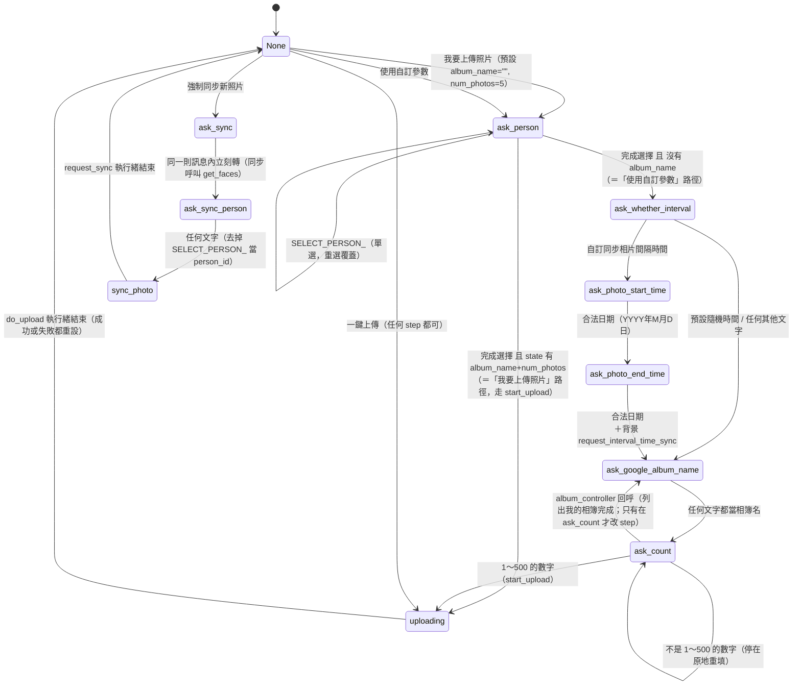

# 對話狀態機（services/message_handler.py）

> 2026-11-20 依程式碼實際行為整理（不是照 `VALID_TRANSITIONS` 畫的；兩者有落差，見下方「已知問題」）。
> 改了 `message_handler.py` / `request_service.py` / `album_controller.py` 的 step 邏輯記得同步更新這份。

## 基本結構

- 狀態存在 process 記憶體 `user_states[user_id]`（dict），所以 gunicorn 只能 1 worker；重啟就全部歸零。
- `state["step"]` 是目前步驟，`state["history"]` 給「返回上一步」用（`set_user_step` 每次轉移前 push 舊 step）。
- `set_user_step()` 會查 `VALID_TRANSITIONS`，但很多地方用 `skip_validation=True` 或直接寫 `state["step"] = ...` 繞過。
- 處理順序（`handle_message`）：
  1. `返回上一步` → `go_back_step`
  2. `一鍵上傳 <personID> <張數> <相簿>` → 任何步驟都直接上傳
  3. 全域指令：`使用自訂參數`、`我要上傳照片`、`強制同步新照片`、`列出我的相簿`、`手動輸入相簿名`、`自訂同步相片間隔時間`、`預設隨機時間`
  4. 依 `current_step`（**進函式時**的 step）分派
- webhook 層在進 `handle_message` 之前先攔 `挑照片 [相簿]` 與 postback（picker，無狀態，不碰 `user_states`）。
- 所有開始上傳的入口（一鍵上傳、完成選擇、輸入張數）都走 `start_upload()`：擋 `is_uploading`、確認有選人，才標記 `is_uploading=True` 並轉 `uploading`。新增入口也要走它。
- 回到 `None` 的方式：背景執行緒 `do_upload` / `request_sync` 結束時**整個 dict 覆蓋**重設，或 `返回上一步` 退到 history 空。

## 狀態圖（實際行為）

`返回上一步`：pop history；history 空就重設成 `None`。`uploading`、`sync_photo` 沒有出邊，只能靠執行緒重設、全域指令或返回上一步離開。

## 已知問題（2026-11-20 review）

依嚴重度排序。第 1、2、4 點已於 2026-11-20 修正（`start_upload()`，測試在 `tests/test_state_machine.py`），保留紀錄。

1. ✅ 已修 — **`ask_count` 先轉 `uploading` 才驗證數字**（`handle_message` 的 `ask_count` 分支）。輸入非數字 → 回「請輸入正確的數字」，但 step 已經是 `uploading`；再輸入數字只會得到預設提示，流程卡死，要按返回或重新開始。
2. ✅ 已修 — **「完成選擇」直接上傳的路徑沒設 `is_uploading = True`**（`handle_person_selection`）。連點兩次會開兩個 `do_upload` 執行緒；靠 photo-syncer 的 409 擋，LINE 端的防重複沒作用。
3. **`do_upload` 結束時整個覆蓋 `user_states[user_id]`**。上傳期間使用者若開始新流程（例如又按「我要上傳照片」選到一半），上傳一結束進度就被清掉；手上的 `state` 參照也跟 `user_states` 脫鉤。
4. ✅ 已修 — **`album_controller` 不看目前 step 就寫 `ask_google_album_name`**。從 `None` 按「列出我的相簿」→ 選相簿 → 選張數 → `selected_person_id[0]` IndexError，被吞成「發生錯誤」，且 step 已卡在 `uploading`（同第 1 點）。
5. **強制同步流程沒顯示人物列表**：`request_person_id` 同步抓 faces 但只回「請先選擇人物」純文字，沒送 face bubbles；`ask_sync_person` 把任何輸入當 person_id 送出，沒驗證是數字。
6. **舊 state 殘留**：`我要上傳照片` 設了 `album_name=""` 之後若中途放棄、改按 `使用自訂參數`，`完成選擇` 會因為 `album_name` 還在而直接上傳到空相簿名，跳過自訂參數的問題。判斷路徑應該用明確的 flag（例如 `state["mode"]`），而不是「有沒有 album_name 這個 key」。
7. **`VALID_TRANSITIONS` 跟實際不符**：`start` 從沒用到；`ask_person → uploading`、`→ ask_google_album_name` 實際走 skip/直寫；`強制同步新照片` 有驗證（不在 `None` 會報「非法狀態轉移」→ 通用錯誤），但 `我要上傳照片` 沒驗證，兩個全域指令行為不一致。現在這張表大多是裝飾。
8. 小問題：
   - `handle_custom_parameters` 呼叫 `select_person` 兩次（第一次的回傳被丟掉，第二次必定回「仍在載入中」）。
   - `handle_start_upload` 在 `select_person` 之後才設 `faces_loading=True`：faces 已快取時會一直是 True（直到重設）。
   - 重設用的 key 是 `selected_person_ids`（複數），其他地方都用 `selected_person_id`；靠 `handle_message` 的 `setdefault` 補回來才沒出事。
   - `go_back_step` 退回 `ask_person` 時的 quick reply 有「不需要上傳」，但沒有任何地方處理這個指令；而且 `handle_message` 對 `go_back_step` 的回傳又包一次 `add_back_button_to_message`，返回鍵會重複。
   - `預設隨機時間` 靠「進函式時的 `current_step`」fall-through 到 `ask_whether_interval` 分支才回相簿選項，是碰巧能動。

## 剩下的修的方向（尚未動手）

- 執行緒結束時只在 `is_uploading` 仍為這次上傳時重設，且只清上傳相關欄位，不覆蓋整個 dict（第 3 點）。
- 用 `state["mode"] in {"quick", "custom"}` 區分兩條上傳路徑（第 6 點）；`VALID_TRANSITIONS` 要嘛照實際補齊並拿掉 skip，要嘛整個刪掉（第 7 點）。
